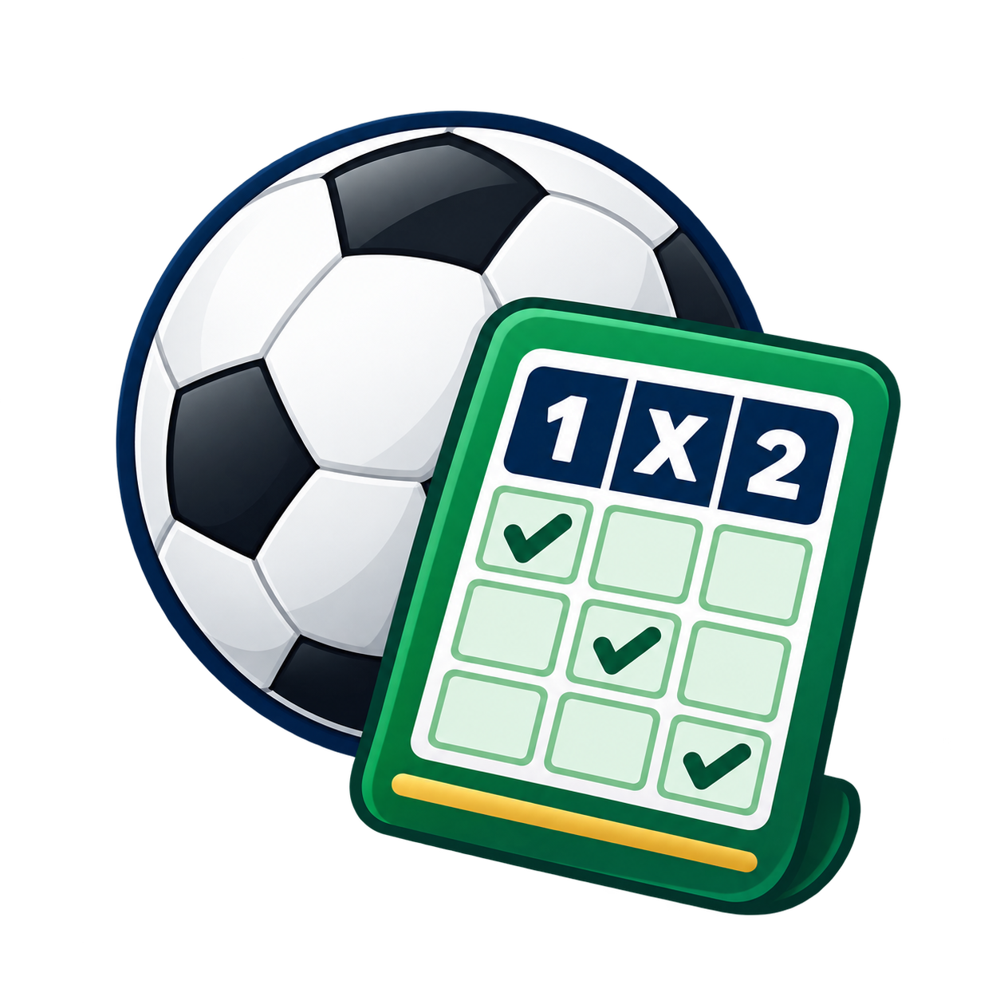

# Quiniela Local



Aplicación de Quiniela para escritorio y Android. La versión de escritorio
puede leer los datos instalados por WIN1X2; ambas versiones descargan datos,
porcentajes y marcadores directamente de sus proveedores públicos.

## Quiniela AI Studio — v1.0.0

Interfaz gráfica en español que conserva la experiencia visual de Quiniela Local:
fondo azul, boleto compacto siempre visible a la izquierda, casillas 1/X/2 y
Pleno 0/1/2/M, secciones a la derecha y **Descargar datos** en la cabecera.
El núcleo está en `src/quiniela_ai_studio/{domain,application,infrastructure,ui}`.

Nuevo: **Optimizar mis apuestas** calcula una cartera por presupuesto/objetivo y
muestra una propuesta antes de aplicar. Incluye cobertura uniforme/ponderada
14/13+/12+/11+/10+, comparación, distancias, aportación marginal y auditoría.
El verificador independiente comprueba las columnas reales de las reducidas.
**TuLotero** prepara boletos de Pleno común y TXT/CSV para introducir manualmente:
no sube archivos, envía apuestas ni cobra. El Pleno es **Manual** por defecto;
elige **Automático** explícitamente si quieres que lo modifiquen las barras.
[Manual y límites v1.0.0](docs/STUDIO_V1_0.md).

Linux Mint, Python **3.11 o posterior**:

```bash
./run_studio.sh
```

El primer arranque crea el entorno e instala PySide6 y platformdirs. Después
funciona sin conexión con la demo y los datos ya importados. Windows:
`run_studio.bat` (preparado, pendiente de ejecución nativa).

1. En Inicio, pulsa **Probar ejemplo de 6 apuestas**: 6 apuestas, 4,50 € de demo.
2. Edita signos y Pleno en el boleto; las selecciones parciales se guardan.
3. En **Normal**, mueve la barra: el boleto se actualiza automáticamente.
   Genera, revisa hasta 100 filas y exporta TXT/JSON.
4. Para datos reales, **Descargar datos** o Configuración → importar carpeta/ZIP.
   En Crear, **Descargar porcentajes** actualiza realmente por
   Internet las fuentes del sistema abierto, sin cambiar signos ni apuestas.
   **Mercado** son estimaciones publicadas de casas de apuestas; **popularidad**
   son signos jugados en Quinielista. No son equivalentes ni garantizan aciertos.
   La fuente y hora de captura aparecen debajo. Las barras aplican la fuente
   elegida respetando partidos bloqueados; no inventan valores si falta.
5. En **Aciertos**, el marcador y tus aciertos/fallos se actualizan solos. La demo usa resultados manuales.
6. Puedes marcar varios goles por equipo en el Pleno; cada pareja aumenta apuestas y coste.
   Los porcentajes 0/1/2/M aparecen debajo de sus casillas, en filas separadas, según mercado o
   popularidad. Descarga porcentajes para incorporarlos a la quiniela abierta.
   En modo **Automático**, la barra preselecciona el Pleno: nivel 0 elige un marcador,
   nivel 10 los 16. Puedes ajustar las casillas después. Si faltan datos conserva
   tu Pleno con aviso. El contador muestra columnas × parejas del Pleno y coste;
   generación y TXT incluyen todas las parejas seleccionadas.
7. **Reducidas** tiene una base independiente de Normal. Elige entre seis tipos
   de tablas BOE 2009: se proponen fijos/dobles/triples propios por porcentajes,
   se muestran columnas y coste con el Pleno y puedes ajustar las casillas.
   **Generar reducida** produce sus apuestas exactas sin tocar la normal.
   Cambiar entre Normal y Reducidas recupera cada sistema por jornada.
   **Diferenciación del público** (0–10), disponible en ambos modos, compara
   mercado y popularidad de Quinielista: un criterio original de selección,
   no una probabilidad ni cálculo de rentabilidad. Puede reducir aciertos y
   no garantiza premios mayores. Requiere ambas fuentes y seleccionar Mercado.
8. **Guardar apuestas (TXT)**, en la cabecera, guarda las apuestas de la quiniela
   abierta. En Mis Sistemas puedes guardar directamente la fila elegida. Al
   terminar aparecen la ruta, el número de apuestas y los pasos para cargar
   manualmente el TXT en la web. **JSON** conserva el proyecto para recuperarlo.

Los desarrollos grandes tienen **Guardar todas las combinaciones**,
que escribe sin expandir todo el universo en RAM. Los sistemas reducidos
exportan sus apuestas exactas. El precio se configura en Configuración para
sistemas nuevos; los existentes conservan su regla y fuente congeladas.

```bash
./run_studio.sh --self-check
.venv-studio/bin/python -m pytest -q
RUN_PC_GUI_TESTS=1 python3 -m unittest discover -q
```

[Instalación, recorrido y aceptación v0.1](docs/STUDIO_V01_ENTREGA.md) ·
[Funciones de datos integradas](docs/STUDIO_FUSION.md) ·
[Índice](docs/00_INDICE.md)

Se conserva `python3 app.py` y el acceso Quiniela Local como respaldo.
No se declara paridad completa, IA entrenada, garantías económicas ni soporte
nativo Windows comprobado. Las garantías combinatorias se etiquetan por universo
y método de verificación. Android queda fuera de este desarrollo.

## Aplicación Android autónoma

El APK para Android 10 o posterior está en
[`dist/QuinielaLocal-Android-1.1.1.apk`](dist/QuinielaLocal-Android-1.1.1.apk).
Es compatible con el Samsung Galaxy S20+ y funciona sin PC ni servidor.

En el teléfono:

1. Descarga o copia el APK.
2. Ábrelo desde **Mis archivos**.
3. Si Android lo solicita, permite instalar aplicaciones desde esa fuente.
4. Instala **Quiniela Local** y pulsa **Actualizar datos**.

La aplicación Android descarga por sí sola la jornada, porcentajes y
resultados; conserva los pronósticos en el móvil y guarda las apuestas en
`Descargas/QuinielaLocal`. Incluye selecciones múltiples, generación y filtros,
optimización por presupuesto, importación/exportación TXT, marcadores,
comprobación de aciertos y escrutinio. La validación y el pago se realizan en la
web externa que se abre desde **Subir TXT y jugar**; la app nunca guarda
credenciales ni confirma compras.

La versión 1.1 incorpora las barras **Cobertura progresiva** y **Ajustes
rápidos** (0–10), distancia entre X, comparación/coincidencias, análisis,
histórico y consulta de temporadas y jornadas publicadas. Los desarrollos,
TXT importados y condiciones se guardan por temporada/jornada: al navegar no
se mezclan apuestas. Solo la jornada en curso admite edición; las anteriores
y futuras son de consulta. **En curso** vuelve a la quiniela editable.
Las descargas se ejecutan en segundo plano y los datos quedan disponibles
sin conexión tras la primera actualización. Véase [Android](android/README.md).

## Funciones del escritorio anterior (Tkinter, respaldo)

- Detecta la temporada y la jornada vigente.
- Lee los 15 partidos y horarios desde `Datosg/PRE*.txt` y `Datosg/Hor*.txt`.
- **Descargar datos** actualiza los archivos de `WIN1X2/Datosg` y los porcentajes
  desde sus proveedores, sin ejecutar WebW1X2.exe; se pueden consultar sin conexión.
- Traduce códigos mediante `Datosg/WEQUIPOS.TXT`.
- Calcula una orientación 1/X/2 con hasta ocho resultados recientes de cada
  equipo y una pequeña corrección por ventaja local.
- Guarda automáticamente el pronóstico del usuario.
- Exporta una quiniela legible en formato de texto.
- Valida y copia los 14 signos más el marcador del Pleno al 15.
- Abre la carga de archivos de Quinielista para validar y pagar el TXT después
  de que el usuario revise jornada, columnas, Pleno e importe.
- Genera entre 2 y 100 **columnas más probables**, ordenando combinaciones
  completas por la probabilidad conjunta de sus 14 signos sin recorrer de
  forma exhaustiva las 4.782.969 combinaciones posibles.
- Optimiza el presupuesto usando únicamente las columnas del desarrollo de origen;
  permite restaurarlo y conserva las apuestas, sistemas y versiones por jornada.
- Compara modelo deportivo y porcentajes jugados sin tratarlos como la misma fuente.

El cálculo usa 0,75 € por apuesta; el optimizador requiere al menos dos apuestas
de origen y un presupuesto de 1,50 €. No se añaden apuestas para completar mínimos.
La reducción disponible es una heurística de probabilidad/diversidad; la cobertura
mostrada es una estimación del modelo, no un certificado matemático ni rentabilidad.

La probabilidad mostrada es un modelo sencillo, no una garantía ni una
recomendación de apuesta. Cuando no existe historial suficiente, se usa una
estimación neutral.

Por seguridad, Quiniela Local no guarda credenciales ni realiza compras. La
confirmación final se hace siempre en la web de validación elegida por el usuario.

## Ampliación de la versión de PC

El [plano técnico de Quiniela AI Studio](docs/ESPECIFICACION_PC.md) recoge los
15 módulos, siete secciones, estado real de la base, contratos matemáticos,
filtros, arquitectura, fases y pruebas de aceptación. Es una especificación
de desarrollo: no significa que las funciones nuevas ya estén implementadas.
La ampliación está limitada al escritorio; Android queda sin cambios.

La [primera entrega de PC Studio](docs/PC_STUDIO_FASE1.md) ya incorpora las siete
secciones, navegación de jornadas, sistemas y versiones SQLite, comparación
modelo/público, conservación del desarrollo de origen y correcciones del
escrutador. Mantiene los editores actuales de Tkinter; el resto de módulos y la
paridad con la versión Qt siguen pendientes. Ejecuta `python3 app.py` para abrir
esta versión Tkinter o `./run_studio.sh` para abrir la nueva versión Qt.

## Ejecución

```bash
python3 app.py
```

Si la aplicación no está dentro de la carpeta de WIN1X2, indica la carpeta de
datos de esta forma:

```bash
WIN1X2_DATA_DIR=/ruta/a/WIN1X2/Datosg python3 app.py
```

Para comprobar únicamente la lectura de datos:

```bash
python3 app.py --check
```

`update_and_run.sh` actualiza el repositorio con un avance rápido desde GitHub
y abre la aplicación. Si no hay conexión, utiliza la última versión local.

## Seguimiento en directo

En **Comprobar aciertos y premios**, la pestaña **Marcadores en directo** consulta
el marcador público de Quinielista/Dataradar al abrir y cada 60 segundos. Puedes
desactivar el refresco automático o pulsar **Actualizar ahora**. Muestra la hora
de origen y de consulta; la frecuencia y el retraso de los resultados dependen
del proveedor. Si falla la conexión, avisa y conserva la última consulta visible.

**Tus aciertos provisionales** compara tu desarrollo o TXT con los partidos que
ya tienen marcador, sin tratar los pendientes como empates. Los confirmados
cuentan únicamente partidos finalizados; el máximo posible solo descuenta fallos
definitivos. El Pleno usa M para tres o más goles. No calcula premios a partir de
marcadores provisionales: **Escrutinio oficial** conserva la consulta de WIN1X2.
El directo valida temporada, jornada y numeración; si la fuente ya no ofrece una
jornada antigua, se puede consultar su escrutinio local.
